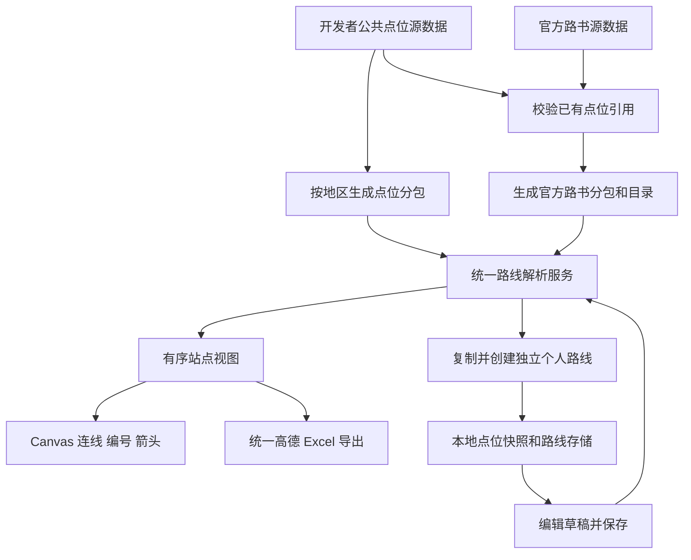

# PlayBook 官方路书、个人路线与高德 Excel 导出设计

设计版本：2.0  
整理日期：2026-11-21（北京时间）  
文档状态：官方路书、个人副本及高德导出仍为待实现的目标设计；反馈点位与反馈路书双入口已按新增需求接入，具体进度以代码和验收为准。

本文整合全国吃玩地图、统一点位、客服反馈、官方路书导入、个人路线编辑、本地保存、高德 Excel 导出和代码分包要求。原有功能背景见[现有设计文档](/D:/PlayBook/吃玩地图-微信小程序设计.md)。涉及新版路书、存储和分包的目标规则，以本文为准；未提及的现有地图与反馈能力继续保留。

## 1. 目标与实现边界

### 1.1 必须支持的功能

1. 地图沿用原生微信小程序和 Canvas 前端渲染，不引入业务后端。
2. 吃、玩共用一份统一字段的公共点位库，只有开发者可以新增或修改公开点位。
3. 开发者可以导入数据新增官方路书，路书只引用已经存在的公共点位。
4. 地图按路书站点数组的顺序绘制连线、方向箭头和站点编号，支持跨城市、跨省份。
5. 用户可以将官方路书复制到「我的路线」，得到独立的个人副本。
6. 个人副本可以改名、增删已有地点、调整顺序、修改天数和提示，保存到本机。
7. 官方路书和已保存的个人路线均可以导出高德 Excel，使用同一个导出模块。
8. 地图边界、公共点位、官方路书、Excel 导出模块分别组织，按需加载，校验单包及总包大小。
9. 保留当前用户反馈流程：复制 JSON，打开微信原生客服，用户粘贴并发送，开发者审核后导入。

### 1.2 第一版的明确边界

- 「按站序连线」是地点之间的行程示意线。第一版不根据行政边界推导实际道路，也不提供实时导航或实时位置。
- 「导出高德 Excel」首先指匹配已提供模板的地点导入表。Excel 行序、地点列表顺序、高德导航站序分别处理。
- 尚未确认的高德完整路线文件结构不作为已支持能力，不承诺上传点位表后自动严格按原站序导航。
- 新增官方路书不能自动创建缺少的地点。缺失点位必须先经过开发者审核并录入公共库。
- 官方内容随新版代码包发布；仅在开发电脑导入数据，不会立刻推送给所有用户。
- 「我的路线」保存于本机，没有账号同步。清理小程序数据、系统清理或换设备可能导致本地内容不可用。

### 1.3 当前已有能力和需要改造的部分

| 项目 | 当前情况 | 本设计目标 |
| --- | --- | --- |
| 全国地图 | 已有全国概览和地区地图分包 | 继续复用 |
| 公共点位 | 文件与地图边界分开，但全部点位仍由主包集中读取 | 独立点位分包及统一按需读取 |
| 个人路线 | 按城市保存，站点中有名称、类别和坐标快照 | 全局跨城路线、本地完整点位快照、旧数据迁移 |
| 重复停靠 | 当前校验禁止重复 pointId | 使用独立 stop.id，允许同一地点多次停靠 |
| 站点详情 | 当前主要按正在浏览的城市查找 | 按站点 cityId 和 pointId 查找 |
| 官方路书 | 尚未实现 | 数据导入、浏览、复制 |
| Excel 导出 | 尚未实现 | 官方与个人路线共用的高德点位表导出 |
| 分包生成 | 当前地图生成脚本会整体写入 subPackages | 统一合并地图、点位、路书、导出包配置 |
| 数据校验 | 已有点位、地图及单包体积校验 | 增加路书引用、总包大小、导出及迁移校验 |

## 2. 产品界面与交互

### 2.1 保留现有地图风格

- 顶部左侧显示小程序 Logo，右侧两行文字为「吃玩书」和「PlayBook」；顶部右侧使用微信原生胶囊。
- 城市选择放在品牌区域下方。全屏地图不再套白色卡片，不展示「广东城市地图」「茂名吃玩地图」等大标题。
- 底部为白色胶囊导航「吃／玩／书」，当前入口使用黑底白字，主要按钮为黑色圆角胶囊。
- 地图支持单指拖动、鼠标滚轮与双指缩放；选择城市只调整视角并高亮对应城市外轮廓。
- 底栏上方操作行的左侧黑色对话浮球为「反馈点位」，右侧黑色书本浮球为「反馈路书」，中间保留列表按钮。
- 城市、地点、路书、编辑、反馈面板打开时，地图保持清晰，不增加模糊滤镜或灰色遮罩。
- 继续处理原生 Canvas 层级问题：需要时显示当前画布清晰快照，不把「清晰快照」实现成模糊背景。
- 地点详情保留「复制地址」「新建路线」两个等宽黑色按钮。

### 2.2 「书」的结构

「书」内提供「官方路书」「我的路线」两个选项，地图继续作为背景。

| 区域 | 内容与操作 |
| --- | --- |
| 官方路书列表 | 名称、简介、出行方式、建议天数、站点数、途经城市；支持搜索和地区筛选 |
| 官方路书详情 | 按天分组的有序站点、地点详情、路线提示；「复制到我的路线」「导出高德 Excel」 |
| 我的路线列表 | 用户创建及从官方复制的路线；查看、编辑、导出、删除 |
| 个人路线详情 | 当前已保存的站序和提示；「编辑路线」「导出高德 Excel」 |
| 编辑面板 | 改名、选择已有地点、排序、移除、天数分组、标签与提示；保存或取消 |

首次进入「书」且没有选中路线时，显示官方路书列表。已有选中路线时恢复其视图；个人路线数据损坏时展示读取问题，不能用空列表覆盖原数据。

### 2.3 城市视角与选中路线分开

页面分别维护 `mapCityId` 和 `selectedRouteRef`。

- `mapCityId`：当前城市高亮及地图定位。
- `selectedRouteRef`：`{ type: 'official' | 'personal', id }`，标识正在查看的路线。
- 切换城市不清空正在查看的跨城路线，不切换成该城市的另一条个人路线。
- 切到「吃／玩」时显示当前城市对应点位，保留路线选择和未保存草稿；返回「书」可恢复。
- 初次打开或主动点击「查看全程」时适配整条路线。普通重绘、底图加载完成和标签更新不反复重置用户视角。

## 3. 总体数据架构



必须区分三种数据：

1. 公共点位：开发者维护，随包发布，每个正式点位只保留一个发布副本。
2. 官方路书：引用公共点位并表达顺序、日程和提示，不重复保存地点详情。
3. 个人路线：引用地点，同时在用户设备保存所选地点的快照，以支持独立编辑和离线重开。

个人快照是本地用户数据，不是再次新增公开点位，也不计入小程序上传代码包。

## 4. 公共点位模型

### 4.1 统一八个字段

| 字段 | 类型 | 规则 |
| --- | --- | --- |
| `id` | string | 城市内唯一且稳定；下架后不复用 |
| `provinceName` | string | 沿用目录名称，末尾不带「省」；直辖市如「北京」 |
| `cityName` | string | 沿用目录名称，末尾不带「市」；直辖市与 provinceName 相同 |
| `category` | string | 只允许 `eat` 或 `play` |
| `name` | string | 地点名称 |
| `coordinate` | number[2] | GCJ-02，顺序为 `[经度, 纬度]`，正式点位不得为 null |
| `address` | string | 详细地址，保留区县、道路、门牌或具体入口信息 |
| `description` | string | 地点本身的介绍；区域参考点需说明其用途 |

吃和玩的字段、类型、验证规则完全一致。省级编码和城市编码使用字符串，保留目录原值；自治区、特别行政区的简称规则以目录为准，不自行拼接或删除名称。

### 4.2 唯一引用

跨城唯一键为 `cityId + ':' + pointId`，例如 `440900:first-beach`。`cityId` 指正式点位库所属的地图城市，不是任意反馈城市编号。县级市反馈归档到所属地图后，官方路书应使用归档后的城市编号。

不能只按地点名称关联，也不能假设所有城市中的 point.id 都全局唯一。公共点位模型仍保持八字段，cityId 通过所属目录和路线站点表达。

## 5. 官方路书模型

### 5.1 路书字段

| 字段 | 作用 |
| --- | --- |
| `schemaVersion` | 路书结构版本，首版为 1 |
| `id` | 稳定的官方路书编号 |
| `version` | 同一路书的内容版本，编排变化后递增 |
| `name` | 路书名称 |
| `summary` | 简介 |
| `travelMode` | `drive`、`cycle`、`walk` 等已实现的出行类型 |
| `days` | 建议天数，正整数，覆盖全部站点的 day |
| `updatedAt` | 工具生成的更新时间 |
| `stops` | 有序站点数组，是行程顺序的唯一依据 |

### 5.2 站点字段

| 字段 | 作用 |
| --- | --- |
| `id` | 此次停靠的稳定编号，在该路书内唯一 |
| `cityId` | 所属正式地图城市编号 |
| `pointId` | 引用公共点位 id |
| `day` | 第几天，从 1 开始 |
| `tags` | 路书场景标签，例如 `food`、`photo`、`sunset` |
| `note` | 该路线中的停靠、拍照、用餐或游玩安排 |

拍照点仍是 `category: 'play'` 的统一点位，`photo` 只作为站点标签。标签不增加新的点位类别或单独点位字段。

### 5.3 可校验的示例

示例只演示数据结构，引用现有茂名点位，不代表经过实地核验的旅游推荐。

```json
{
  "schemaVersion": 1,
  "id": "maoming-coast",
  "version": 1,
  "name": "茂名吃玩示例路书",
  "summary": "用已有点位验证导入、复制、编辑和导出流程。",
  "travelMode": "drive",
  "days": 1,
  "updatedAt": "2026-11-21T00:00:00.000Z",
  "stops": [
    {
      "id": "stop-001",
      "cityId": "440900",
      "pointId": "shuidong-duck",
      "day": 1,
      "tags": ["food"],
      "note": "填写本次行程的用餐安排。"
    },
    {
      "id": "stop-002",
      "cityId": "440900",
      "pointId": "first-beach",
      "day": 1,
      "tags": ["photo"],
      "note": "填写本次行程的拍照提示。"
    }
  ]
}
```

### 5.4 顺序、重复停靠与更新

- 数组第一个元素就是第 1 站。不要同时维护可能冲突的 `order` 字段。
- 站点移动时保留 stop.id，站点编号由当前数组下标派生。
- 同一 cityId、pointId 可以出现多次，但每次有不同 stop.id。海南环岛的起终点可以引用同一地点。
- 天数沿行程顺序非递减。跨天移动站点时，编辑器将该站归入目标天，最终再次校验。
- 不根据距离自动优化站序。若以后增加优化功能，必须作为用户主动选择的独立操作。
- 同一路书 id 再次导入用于更新；相同版本、相同规范化内容视为重复导入并跳过。修改内容却沿用版本号时拒绝导入，提示递增版本。
- 站点编排版本与公共点位版本分别管理；本次发布生成统一 contentVersion，避免跨版本缓存混用。

## 6. 官方路书的开发者导入

### 6.1 日常工作流程

1. 从模板创建路书，填写基本信息。
2. 在开发者点位清单中按城市和名称搜索，选中后取得 cityId、pointId；清单可附地址辅助区分同名地点。
3. 排列 stops，填写 day、tags、note。首次建档时工具可生成稳定的 route.id 和 stop.id，后续保留。
4. 导入器检查引用及结构；本功能不新增、不覆盖公共点位。
5. 在暂存目录生成官方目录、数据分包、加载索引和体积报告；通过全部检查后再替换生成物。
6. 开发者预览站序、跨城地图、复制编辑及导出结果，随后更新发布小程序。

G318、海南环岛的地点尚未入库时，导入器输出缺失的城市、pointId、站点编号和查找建议。开发者先用现有点位录入流程补齐，再重新导入；导入器不把名称猜测成某个已有地点。

### 6.2 拟议工具入口

以下命令是后续实现接口，当前仓库尚未提供这些新工具。

```powershell
node tools/import-routebook.js --from imports/maoming-coast.json
node tools/build-content.js --scope routebooks
node tools/validate-data.js
```

导入器将验证后的源文件写入 content/routebooks。构建工具在一次发布中统一生成目录、分包配置和加载器。仅更新路书时可复用已验证的地图、点位生成物，不必重新下载全国区划。

### 6.3 校验与失败处理

至少检查：结构版本、稳定 ID、路书版本、非空名称、至少两次有效停靠、至少两个不同的有效地点、stop.id 唯一、cityId/pointId 存在、坐标有效、day 合法、标签和说明为允许的文本结构。

重复停靠允许，但只有同一个地点反复出现而没有任何实际移动的路线不能作为有效行程保存。名称相同不构成重复判断，ID 才是身份依据。

任一检查失败时，不修改正式源数据、app.json 或现有分包。更新、重试和批量导入必须可重复执行。删除公共点位前检查哪些官方路书仍在引用；正式构建不得留下悬空引用。

## 7. 复制到「我的路线」

### 7.1 复制行为

点击「复制到我的路线」时，执行一次完整操作：

1. 加载并验证官方路书及其引用的全部点位。
2. 新建个人路线 id，不使用官方 route.id 作为个人路线主键。
3. 深复制行程字段和站点，给个人站点生成新的稳定 stop.id，保留原顺序、day、tags、note。
4. 将该路线用到的公共点位按复合键去重后保存为本地点位快照。
5. 保存 origin，记录复制来源及当时官方版本；提交本地保存成功后，才显示「已复制」。
6. 切换到「我的路线」，选中这个已保存副本并打开其编辑草稿。

取消随后打开的编辑面板，只放弃这次编辑；已复制的初始副本仍保留在「我的路线」。复制因网络、点位解析或本地容量失败时不创建半条路线，并保留官方路书视图。

### 7.2 独立性

- 个人副本与官方对象不能共享可变数组或点位对象引用，避免编辑副本影响官方页面。
- 官方路书发布新版，不自动覆盖已复制的个人副本。
- 同一官方路书可以主动复制多份，每份拥有不同个人路线 id；请求执行期间禁用重复点击，避免意外重复。
- 删除个人副本不删除官方路书，也不删除公共点位。
- 用户只能向个人路线添加公共库中的已有地点；不会由编辑器新增公开地点。

### 7.3 为什么保存本地点位快照

官方路书使用公共点位的当前发布内容。个人路线则以自己的快照为准，确保地点改名、移位、下架或暂时无法下载点位包时，用户已保存的行程仍可重开、绘图和导出。

同一地点在个人路线中多次停靠，只在该路线的 pointSnapshots 保存一份详情。快照不写回公共点位库。用户主动添加已有地点时立即保存它的快照；已用不到的快照在成功保存后移除。

如以后提供「刷新地点信息」，应由用户主动触发，预览变化后更新快照并形成个人路线新版本；找不到的原地点保留旧快照，不静默删除站点。

## 8. 个人路线数据与编辑

### 8.1 逻辑数据模型

以下为逻辑对象；实际本地写入可拆成分块，不要求全部塞进一个 storage key。

```json
{
  "schemaVersion": 2,
  "id": "user-demo-001",
  "version": 1,
  "name": "茂名吃玩示例路书 · 我的副本",
  "summary": "在官方编排基础上调整自己的行程。",
  "travelMode": "drive",
  "days": 1,
  "createdAt": "2026-11-21T00:00:00.000Z",
  "updatedAt": "2026-11-21T00:00:00.000Z",
  "origin": {
    "type": "official",
    "routeId": "maoming-coast",
    "routeVersion": 1,
    "copiedAt": "2026-11-21T00:00:00.000Z"
  },
  "stops": [
    {
      "id": "user-stop-001",
      "cityId": "440900",
      "pointId": "shuidong-duck",
      "day": 1,
      "tags": ["food"],
      "note": "填写自己的用餐安排。"
    },
    {
      "id": "user-stop-002",
      "cityId": "440900",
      "pointId": "first-beach",
      "day": 1,
      "tags": ["photo"],
      "note": "填写自己的拍照安排。"
    }
  ],
  "pointSnapshots": {
    "440900:shuidong-duck": {
      "id": "shuidong-duck",
      "provinceName": "广东",
      "cityName": "茂名",
      "category": "eat",
      "name": "水东鸭粥",
      "coordinate": [111.007264, 21.507219],
      "address": "电白区水东城区（探店参考范围）",
      "description": "地点快照示例，地图标记指向水东城区。"
    },
    "440900:first-beach": {
      "id": "first-beach",
      "provinceName": "广东",
      "cityName": "茂名",
      "category": "play",
      "name": "中国第一滩",
      "coordinate": [111.0525, 21.4549],
      "address": "电白区南海街道海滨二路中国第一滩景区",
      "description": "地点快照示例，正式行程应核对具体入口。"
    }
  }
}
```

用户从零新建的路线也使用同一模型，origin.type 为 `user`，不必伪造官方来源。模型中的示例 id 用于说明，正式运行生成唯一编号。

### 8.2 编辑规则

- 支持改名、简介、出行方式、建议天数和路线专属说明。
- 支持添加其他城市的已有点位、移除站点、上移下移或拖动排序、修改某站所属天数。
- 允许再次添加同一地点作为返回站，每次生成新的 stop.id。
- 调整 day 分组时必须同步更新数组位置，避免列表分组和实际连线顺序不一致。
- 编辑地点的行程提示只改 stop.note，不改公共 point.description。
- 编辑始终操作草稿。取消编辑恢复最近一次已保存版本，地图预览也恢复；保存成功才替换正式本地版本。
- 保存失败时保留草稿并允许重试，不提示成功，不覆盖上一次已保存内容。

### 8.3 导出已保存版本

个人路线详情的导出入口读取最新已提交版本。存在未保存草稿时，导出面板提供「保存后导出」或「导出上次保存版本」，不会默认把草稿当作已保存路线。

选择「保存后导出」时先完成保存，再固定本次导出使用的版本；保存失败则不继续导出。导出期间发生的新修改不混入已经开始生成的文件。

## 9. 本地存储、容量与旧数据迁移

### 9.1 新存储不再以城市隔离路线

新索引使用 `playbook:routes:v2:index`，保存个人路线摘要和当前已提交版本引用。路线正文按个人 route.id 和 revision 单独保存，避免跨城路线被强制归入一座城市。

建议键命名：

```text
playbook:routes:v2:index
playbook:routes:v2:route:<routeId>:<revision>:manifest
playbook:routes:v2:route:<routeId>:<revision>:part:<n>
playbook:routes:v2:migrations
```

官方包属于只读发布数据，不整库复制进 wx Storage；本地只保存当前选择等轻量状态和用户主动创建的个人路线。

### 9.2 可靠保存

1. 保存前读取当前版本，避免旧草稿静默覆盖后来的提交。
2. 将本次完整逻辑对象按可独立重组的 UTF-8 文本分块，工程目标每块不超过 256 KiB；不能截断 Unicode 字符。
3. 写入新 revision 的全部分块及 manifest，读回校验长度和结构。
4. 最后更新索引中该路线的版本指针，作为提交点。
5. 提交并核对成功后再清理旧 revision；失败产生的未引用块后续回收。

不要把多个 storage key 的写入当作原生事务。若正文写完而索引提交失败，仍以旧索引为准，不损坏旧路线；若完整性检查失败，保留可恢复旧版本并提示。

微信文档当前说明：单个 key 最大 1 MB，本地缓存合计上限 10 MB；实际使用前同时读取 `wx.getStorageInfoSync()` 的容量信息，并给版本切换留余量。个人快照、草稿缓存等都占用本地额度，不能把「不占代码包」理解成无限容量。开启加密存储时另按对应额度计算，本版不默认启用加密选项。[写入缓存](https://developers.weixin.qq.com/miniprogram/dev/api/storage/wx.setStorage.html) · [读取缓存信息](https://developers.weixin.qq.com/miniprogram/dev/api/storage/wx.getStorageInfoSync.html)

索引增长接近单 key 预算时进行分页；容量不足时只清理无引用临时块，不能自动删除用户路线。清理仍不够则提示用户处理已保存内容，并保留当前未提交草稿。

### 9.3 迁移现有个人路线

现有键为 `eat-play-map:city:<cityId>`，schemaVersion 为 1。新版必须兼容现有已保存路线。

迁移步骤：

1. 枚举旧前缀键，逐条验证，不修改原值。
2. 由旧键补齐站点 cityId；为路线和站点分配稳定的新标识，并记录迁移映射。
3. 保留旧站点已存的名称、类别和坐标，不用新版公共坐标覆盖。
4. 地址、说明、省市名称等缺失信息可从匹配公共点位和城市目录补齐；没有对应记录时保留现有快照，缺失文本使用空字符串并记录迁移状态。
5. 建立新模型并以新存储机制提交，验证可读取后记录迁移完成。
6. 保留旧键作为恢复来源，不因升级立即删除。以后需要清理时单独提示。

迁移必须可重试，同一旧路线不能在每次启动时生成新副本。未知格式、损坏记录不得迁移成空路线覆盖；不同城市相同旧 route.id 必须分别识别。

旧快照有有效坐标时，即使缺少地址仍可显示并导出坐标。迁移快照允许缺失文本为空，公共点位新增的必填规则不因此放宽。地址缺失不能导出成虚构地址；缺少有效坐标且无完整地址时需提示该站不能定位。

保留旧数据和写入新副本需要额外容量。迁移空间不足时保持旧数据可读，暂停该条迁移并提示处理空间；不能为了完成升级先删除尚未验证的旧记录。

## 10. 统一路线解析与地图绘制

### 10.1 统一视图模型

官方路书和个人路线先通过同一解析入口转成 RouteView，绘图与导出不各写一套业务判断。

| 视图内容 | 来源 |
| --- | --- |
| `sourceType`、`routeId`、`version` | 当前选中的路线身份和版本 |
| 名称、天数、出行方式 | 路线本身 |
| `stopId`、`cityId`、`pointId`、`day`、`tags`、`note` | 当前有序站点数组 |
| 地点名称、类别、坐标、地址、说明 | 官方从公共库解析；个人优先使用自己的快照 |
| `globalOrdinal` | 原数组位置加 1，过滤后不重新编排 |
| `resolutionStatus` | 已解析、加载中、加载失败或确实缺失 |

此视图只是运行时组合，不是新增公共点位数据。网络加载失败和点位已删除是不同状态，不能混为一谈。

### 10.2 按原站序画线

1. 按 stops 原顺序解析经纬度。
2. 使用与全国底图相同的投影，转换为世界坐标和屏幕坐标。
3. 按相邻站点 `i → i+1` 生成线段，画黑色虚线和方向箭头。
4. 再绘制黑色编号标记、地点文字和选中状态。
5. 缩放、拖动后重新投影绘制；首屏拟合完整路线，不只拟合当前城市。

不能按照城市目录顺序、异步下载完成顺序、屏幕左右顺序或地点名称排序后连线。

### 10.3 筛选、裁剪与缺失站点

- 类别或拍照筛选只控制标记、标签和列表的可见性，全程连线仍基于完整有序站点。
- 按天查看时显示该天的原有连续线段，保留全程站号；不把不同天的隐藏站点越过后另建捷径。
- 视口裁剪可以跳过不可见线段的绘制，但不能先删除屏幕外站点，再把剩下的点重新串接。
- 某站无法解析时，对涉及该站的相邻线段留空，不把前后两站直接跨接。界面说明缺失站号并提供重试。
- 官方路线全部引用解析完成后，才允许完整复制或完整导出；个人路线有完整快照时不依赖公共包成功下载。
- 同坐标多次停靠不生成无意义的零长箭头；列表仍显示各次停靠，地图可显示组合编号并允许选择对应站点。
- 标签避让只影响标签摆放，不改变站号、原坐标和连线顺序。地图站点 key 使用 stopId，不使用 pointId 或易变数组下标。

### 10.4 道路轨迹扩展

第一版只要求站序示意线。未来如增加沿真实道路的轨迹，数据必须另有来源、坐标系和对应站序版本，不能由 DataV 行政区划自动推算。

个人副本增删、换序或更新坐标后，原官方道路轨迹不能继续冒充编辑后的路径。未重新验证轨迹时，副本回退到站序示意连线。地点站序相同，也不代表高德实时规划的道路与路书历史轨迹完全相同。

## 11. 官方与个人路线共用的高德 Excel 导出

### 11.1 对接目标与依据

目标是高德 App 内的「地图小程序」，电脑端为 [wia.amap.com](https://wia.amap.com/)。不是任意微信导航小程序，也不是直接把文件发送进高德账号。

已核对用户提供的 `D:\下载\导入模板.xlsx`：

- 数据页名称为「标记位置」。
- 说明页为「导入说明」「颜色说明」。
- 当前模板不包含「位置编码」列，也未提供有序路线专用工作表。
- 标记位置第 1 行为下节列出的九列。
- 名称最多 40 字，描述最多 600 字；坐标为 GCJ-02；填写经纬度后地址可不填。
- 文件夹层级用 `/` 分隔，支持按路书和天数分组。

后续将这些已核实规则整理成版本化的 `amap-markers-v1` 适配器。保留必要工作表名称和原始表头，说明页可生成轻量文本；不在表中自加「顺序」列冒充高德已支持字段。去除说明配图后的文件必须先通过真实导入测试，不能凭结构相似就认定兼容。

### 11.2 字段映射

| 列 | 高德表头 | 导出规则 |
| --- | --- | --- |
| A | `名称` | 例如 `D01-001 中国第一滩`；名称前缀按 day 和全程站号生成，名称部分按 40 字限制处理 |
| B | `*经度` | coordinate[0]，数值单元格 |
| C | `*纬度` | coordinate[1]，数值单元格 |
| D | `*地址` | 按已知省、市和详细地址组成，避免重复前缀；不虚构缺失内容 |
| E | `颜色` | 遵循目标地图配置，可留空；PlayBook 黑白界面不要求高德地图也强制黑白 |
| F | `图标(外轮廓)` | 按模板图标编号，可留空 |
| G | `图标(填充物)` | 按模板图标编号，可留空 |
| H | `描述` | 稳定来源标识、天数、站序、类别、拍照标签、地点介绍及路线提示，最多 600 字 |
| I | `文件夹` | 例如 `PlayBook/海南环岛/第01天`，对用户文本中的 `/` 做转义或替换，防止意外多建层级 |

坐标有效时优先输出坐标；旧路线缺少坐标但有完整地址时，可在用户知悉地址匹配方式后导出，不能自动填 0。坐标、地址均不足时阻止该范围的导出并指出站点，不静默漏行。[高德批量导入说明](https://lbs.amap.com/api/wia/tutorial/content/import) · [高德坐标体系](https://lbs.amap.com/faq/advisory/others/39838)

### 11.3 同一导出流程支持两类路线

```text
官方路书 ──读取当前发布的引用与公共点位──┐
                                      ├─ 固定 RouteView 版本
个人路线 ──读取已保存版本和本地快照────┘
                                          ↓
                              按原站序生成高德模板行
                                          ↓
                                写出真正的 .xlsx
                                          ↓
                                 用户保存或分享文件
```

个人副本的导出身份始终是 personal 和个人 route.id，不能因为 origin 是官方就拿官方 id 做更新匹配。否则用户编辑副本后可能错误匹配官方原版的高德数据。

### 11.4 选择导出范围

- 默认导出全程站点，支持按天导出和明确选择类别、拍照标签。
- 筛选只改变导出范围，保留剩余站点的相对原站序和全程站号。
- 同一地点出现在两个停靠位置时，生成两条停靠记录，不按 pointId 去重掉返回站。
- 文件名可用「路线名称-第01天-v2-日期.xlsx」，清理不合法文件名字符。
- 不提供隐藏的自动顺路优化，不根据距离重排导出行。
- 导出前统计行数，工程上将含表头的总行数控制在 50,000 以内；生成后检查文件不超过当前高德 20M 限制。超限提示按天或行程段分开导出，不提供必然被拒收的文件。

### 11.5 稳定标识与文本处理

描述优先写入可解析的短标识，例如：

```text
PB1:{"type":"personal","routeId":"user-demo-001","stopId":"user-stop-002","pointKey":"440900:first-beach"}
第1天，第2站；玩；拍照。
填写地点介绍和这条路线里的停靠提示。
```

`type + routeId + stopId` 识别一次停靠，pointKey 仅用于追溯地点。同一地点被多条路线使用时，不能只按 pointKey 匹配高德记录。

描述压缩时先保留标识、day 和站号，再裁剪介绍及提示，生成前展示被截断数量。名称中的编号保持完整；超长名称的完整文本在描述预算允许时补充。身份编码以文本写入，不转成可能丢精度的 Excel 数字。

写出真实 XLSX，不把 CSV 改后缀。用户的文本输入一律写成文本单元格，不执行公式，也不把前导 `=` 的说明变成公式。

### 11.6 文件生成与发送

- 用户点击导出后再按需加载 XLSX 生成模块；核心逻辑不依赖业务服务端。
- 将生成文件写入小程序可访问的本地文件路径，按当前客户端能力提供预览或文件分享。
- 可使用 `wx.shareFileMessage` 打开文件分享入口，用户自己选择发送对象；不能宣称程序自动发给高德。
- 首次未下载导出分包时需要联网。保存的路线和已缓存导出模块均可用时，才具备本地生成条件。
- 文件成功写出后才提示「文件已生成」；取消分享不等于文件生成失败，也不代表已导入高德。
- 对临时导出文件设置明确清理机制，不能顺带删除个人路线存储。

[微信文件分享 API](https://developers.weixin.qq.com/miniprogram/dev/api/share/wx.shareFileMessage.html)

## 12. 高德站序保证范围与实际导入步骤

### 12.1 三种顺序分开处理

| 顺序 | 能否由本系统保证 |
| --- | --- |
| PlayBook 地图和个人保存站序 | 可以，统一以 stops 数组为准 |
| 导出 Excel 行序 | 可以，按同一数组生成 |
| 高德资源列表显示顺序 | 由高德列表排序设置决定；编号方便核对，不保证导入后默认保持行序 |
| 高德导航站点顺序 | 必须在高德路线编辑中核对；普通点位表不能直接保证 |

高德列表支持按更新时间、距离和名称排序；制作路线支持人工调整地点顺序，也提供智能「顺路排序」。这些操作可能改变用户看到的次序，不能以「导入成功」推导「导航站序完全一致」。[高德电脑端说明](https://lbs.amap.com/api/wia/tutorial/start/pc) · [高德制作路线说明](https://lbs.amap.com/api/wia/tutorial/content/mark)

### 12.2 第一版交付流程

1. 用户在 PlayBook 导出官方或个人路线的高德点位表。
2. 通过微信文件分享等方式将文件转到电脑。
3. 登录 wia.amap.com，进入对应地图，选择 Excel 批量导入。
4. 按文件夹和名称编号核对地点；需要时选择名称升序。
5. 在高德选择地点制作路线，按编号核对并调整实际站序。
6. 保留原定旅游顺序时，不主动选择会重排的顺路排序；确认后再开启导航。

高德公开导入说明目前将 Excel 批量导入列为 PC 操作。页面提示应明确本功能导出的是地点表，不能把按钮写成「一键导入高德并按原路线导航」。

### 12.3 完整路线格式的后续验证

若希望真正传递高德认可的路线顺序，需先在高德制作一条含 2～3 个地点的路线并批量导出，确认路线工作表、站点关联、排序和版本字段。再用改序、重复停靠、跨城等样例验证导入行为。

在没有样本和实测结果前，不凭空增加「制作路线」工作表或排序字段，也不把 KML 中的坐标顺序等同于高德导航站序。完整路线适配是后续扩展，不阻塞本版两类路线的点位 Excel 导出。

## 13. 高德已有数据更新

### 13.1 采用当前后台的实际规则

用户于 2026-11-21 提供的页面提示表明：支持 xls、xlsx、kml、ovkml、csv；单次不超过 50,000 行、20M。使用批量导出后的 Excel，其中相同「位置编码」可被识别为重复数据，并选择替换或新增。

此当前页面信息优先于旧帮助页中「尚不支持覆盖更新」的描述。上述上传限制属于高德文件导入限制，不是微信代码包额度。

### 13.2 两种导出模式

| 模式 | 输入 | 输出 |
| --- | --- | --- |
| 首次导入表 | 官方或个人 RouteView | 九列点位模板，不伪造高德位置编码 |
| 更新已有高德数据 | 当前 RouteView 加用户选择的高德批量导出 Excel | 保留原位置编码和必要结构的更新文件及匹配报告 |

高德位置编码不是 PlayBook 的 pointId、stop.id，也不能默认当作高德开放平台 POI ID。必须从高德导出文件取得并原样保留。

### 13.3 更新匹配

1. 读取高德导出文件，识别实际表头、位置编码和描述中的 PB1 标识。
2. 用 type、routeId、stopId 匹配目标路线的站点，不能仅按名称、坐标或 pointId 猜测。
3. 更新匹配行的名称、坐标、地址、描述及目标文件夹，保留位置编码、必要元数据及其他无关数据。
4. 缺少标识、匹配到多条记录或位置编码异常时，停止对应更新并给出预览报告，不静默覆盖。
5. 新增站点单独生成首次导入表；更新文件只承担已有数据的更新，避免猜测未知格式下空编码的新增行为。
6. 用户回到高德导入更新文件时，按页面选择替换原有数据。

个人路线移除的站点不会因为不在更新文件中就自动从高德删除；应在报告中列出，由用户在高德确认处理。更新后的名称编号也不替代高德路线内部站序调整。

更新适配器需要一份包含位置编码的真实高德导出文件才能完成兼容验证。输入文件在本机处理，不自动上传给开发者。

## 14. 数据源与发布目录

以下为拟议目标布局。`content` 是开发者维护区，位于小程序根目录之外；`playbook` 中的数据包由工具生成。目录继续用 cities 按省编码和城市编码分组，不改为 provinces。

```text
D:\PlayBook\
  content\
    cities\
      440000\440900\points.js       开发者点位源文件，统一八字段
      440000\440100\points.js
      110000\110000\points.js
    routebooks\
      maoming-coast.json             官方路书源文件，只引用已有点位
      g318.json                     实际沿途地点齐备后再制作
      hainan-loop.json
  imports\                          开发者临时导入文件，不打包
  references\amap\                  模板、实测记录等开发参考，不打包
  playbook\
    assets\                         Logo 与界面图标
    pages\home\                     首页、三个底栏入口和面板状态
    components\city-map\            全国 Canvas、点位、路线、手势
    components\route-editor\        通用个人路线编辑器
    data\
      cities.js                     轻量地图城市注册信息
      feedback-cities.js            全国反馈城市选择目录
      point-index.js                城市到点位包的映射，不集中 require 点位正文
      routebook-catalogue.js        官方路书卡片和分包索引
      national\                    地图目录与覆盖清单
      cities\440000\440900\
        boundaries.js               茂名首屏边界
        outline.js                  茂名首屏外轮廓
        points.js                   若保留首屏点位，此处为唯一发布副本
    map-packages\base_0\            全国概览
    map-packages\p44_0\             广东地图边界，其余地区沿用现有规则
    point-packages\poi44_0\         公共点位，按地区与体积分组
    route-packages\book_0\          一批官方路书
    export-packages\xlsx_0\         Excel 生成模块及必要资源
    services\
      point-repository.js           统一点位加载、查找及缓存
      official-routebooks.js        目录、官方路书加载
      personal-routes.js            复制、保存、读取、删除个人路线
      route-resolver.js             两类路线转 RouteView
      route-storage.js              本地分块、版本提交及容量处理
      storage-migration.js          旧城市路线迁移
      route-export.js               固定导出版本、范围和文件流程
      package-loaders.js            统一跨分包加载入口
  tools\
    add-point.js                    审核反馈后写入点位源文件
    import-routebook.js             验证并导入官方路书
    prepare-points.js               生成公共点位分包与索引
    prepare-routebooks.js           生成路书分包与目录
    prepare-national.js             现有地图生成逻辑，改为保留其他包配置
    build-content.js                协调生成、清单合并与原子替换
    validate-data.js                分类型数据和包体积校验
```

该布局是未来改造方案，当前源文件尚未迁移。迁移时核对源文件数量、内容和哈希，保留点位 ID；反馈导入工具、全国地图生成器和验证工具同步切换，避免两处源数据各自修改。

## 15. 微信包大小与按需加载

### 15.1 已核对的规则与当前基线

微信官方当前说明：主包和单个分包均不超过 2M，全部包合计不超过 30M，服务商代开发小程序不超过 20M。实际以上传工具和账号适用规则为准。[微信分包说明](https://developers.weixin.qq.com/miniprogram/dev/framework/subpackages.html)

2026-11-21 本地未改造代码的文件统计如下，采用十进制 MB，不作为微信最终编译包大小证明：

| 内容 | 字节数 | 约合 |
| --- | ---: | ---: |
| 主包 | 421739 | 0.42 MB |
| 其中全部城市 points.js | 9638 | 9.6 KB，包含空城市文件，实际 7 个点位 |
| 其中茂名首屏边界和外轮廓 | 89219 | 89 KB |
| 35 个地图分包合计 | 8797957 | 8.80 MB |
| 主包加分包 | 9219696 | 9.22 MB |

当前尚无主包容量压力，但全部城市点位集中读取的方式不适合长期增长。1.5 MB 是本项目用于留余量的优化预算，不应当写成平台的上传硬限制。

### 15.2 分包职责

| 包类别 | 保存内容 | 触发加载 |
| --- | --- | --- |
| 主包 | 页面、通用绘图与状态逻辑、轻量目录、索引及少量首屏数据 | 启动 |
| 地图包 | 行政边界、外轮廓、必要标签 | 浏览对应地区 |
| 点位包 | 唯一的正式地点详情 | 打开城市点位或解析相关路书 |
| 路书包 | 顺序引用、介绍与提示 | 打开对应官方路书 |
| 导出包 | XLSX 写出逻辑及必要资源 | 用户点击导出 |

使用普通分包配合 `require.async` 读取数据与导出模块，不为这些包开启不必要的独立分包隔离。只有目录和加载函数位于主包，不能再静态 require 全部点位正文。[分包异步化](https://developers.weixin.qq.com/miniprogram/dev/framework/subpackages/async.html)

### 15.3 体积控制原则

1. 按地区聚合点位，再按体积拆包；不为 370 个空城市各建一个空点位包。
2. 小路书可以合并到同一包，大轨迹等以后单独拆分；包名全局唯一，避免与现有 p44_0 等冲突。
3. 每包的工程上限预算宜设为 1～1.5 MB，不要求把小包填满；接近预算先预警，达到平台硬上限则阻止发布。总量另行检查，分包不会减掉总数据。
4. 正式点位在发布目录中只有一份。若茂名首屏点位留主包，点位分包排除同一份点位；维护源文件不能同时默认打入主包。
5. 不把公共点位、全国边界或整座城市数据复制进每条路书。
6. 高德原始 Excel 模板约 1.96 MB，含说明配图，不原样塞入主包，也不为每条路书预存导出文件。
7. 导出库的体积必须实际测量并计入所属包和总量；现场生成文件不代表导出代码零成本。
8. 开发参考、工具依赖、原始 GeoJSON、导入文件和原模板放在 playbook 之外。
9. 本地个人快照、生成后的临时 Excel 不计入上传代码包，但分别占用本地缓存或文件空间，需要单独管理。

### 15.4 统一构建与清单

各生成器返回它管理的包清单，由 build-content 合并并检查 root、name 唯一后写入 app.json。地图生成器不得再用地图包列表整体覆盖 subPackages。校验器也不得把每个非 base_0 包都当成地图 data.js 解析。

建议 manifest 包含 contentVersion、包类别、root、模块入口、内容哈希、字节数以及城市或路书归属。缓存键包含发布内容版本；加载失败清除失败 Promise 以便重试，异步结果只应用于仍然选中的路线或城市。

重复请求同一包共用 Promise。JS 模块下载及引用后的内存保留按微信运行时行为处理，不能声称删除业务 Map 缓存就一定卸载了 require.async 模块。业务侧只缓存必要的解析视图，避免无限复制点位与几何数据。

## 16. 服务接口约定

以下名称是拟议职责边界，不是本次新增的代码：

| 服务 | 主要接口与职责 |
| --- | --- |
| PointRepository | `ensureCities(cityIds)`、`getPoint(cityId, pointId)`；先加载，再同步查已加载数据 |
| OfficialRoutebooks | `list(filters)`、`load(routeId)`；读取目录与对应路书正文 |
| PersonalRoutes | `copyFromOfficial(routeId)`、`read(id)`、`save(draft, expectedVersion)`、`remove(id)` |
| RouteResolver | `resolve({ type, id })`；官方走公共库，个人走已提交快照，返回有序 RouteView |
| RouteStorage | 版本分块、索引提交、完整性核对、容量管理 |
| StorageMigration | 读取旧城市数据并幂等迁移 |
| RouteExporter | `exportAmap({ routeRef, scope, expectedVersion })`；两类路线共用 |
| AmapAdapter | 模板映射、长度处理、来源标识、可选更新文件匹配 |
| PackageRegistry | 包类别清单、按需加载、失败重试、发布版本缓存隔离 |

编辑器不直接修改官方模块、公共点位数组或 storage；地图不自行选择另一条路线；导出器不绕过 RouteResolver 另写一套按城市查找逻辑。

## 17. 用户反馈与公开点位维护

保留圆形反馈浮球、全国城市选择和统一反馈表单。用户填写城市、吃/玩类别、地点名称、详细地址、说明；cityId 和 provinceName 从目录带入，coordinate 在复制时固定为 null，用户不填写 id。

路书反馈使用独立面板，包含最多 40 字的路书名称和按行程顺序填写的 1～50 个地点，每个地点最多 120 字，可以添加和删除。跨城地点由用户在地点文字中注明城市或地址；不要求填写 ID、经纬度，也不会直接生成正式路书或公共点位。复制 JSON 为 `{ type: 'routebook', name, places: [{ order: 1, name }] }`，不带内部表单编号。底部沿用「复制反馈 → 打开客服」，用户粘贴并发送；关闭面板后本次运行中的草稿保留。路书反馈面板也保持地图清晰。

用户复制 JSON 后进入 `open-type="contact"` 客服会话，仍需手动粘贴并发送。开发者绑定客服人员后在[微信官方客服工具](https://mpkf.weixin.qq.com/)查看，审核地点和坐标后通过 add-point 工具写入 content/cities 对应 points.js，再生成分包并发版。

只有开发者维护公共库。用户修改个人路线或给路线写提示，不触发公开点位更新。普通用户界面不增加「发布公共地点」入口。现有复制地址、复制反馈等功能继续按微信平台要求配置；本版不新增实时定位或读取用户现有剪贴板内容的能力。

## 18. 实施步骤

### 阶段一：数据与分包基础

- 迁移点位维护源到 content/cities，保留八字段和全部已有 ID。
- 实现点位仓库、轻量索引及独立点位包。
- 改造包清单合并与分类校验，保持现有全国地图和首屏行为。

### 阶段二：官方路书与统一绘图

- 实现路书 schema、导入器、目录、分包和按需读取。
- 新增官方路书列表、跨城 RouteView、原站序连线和站点详情。
- 先用真实存在的茂名点位验证，不凭空添加 G318 或海南点位。

### 阶段三：个人副本与保存

- 实现全局个人路线模型、本地点位快照及旧数据迁移。
- 实现复制、编辑、保存、取消、删除、跨城选点和重复停靠。
- 验证官方更新与个人副本互不覆盖。

### 阶段四：两类路线的高德 Excel

- 实现统一导出模块、轻量模板适配、文件生成及分享。
- 实测官方路线和改序后的个人路线均能导入高德地点。
- 展示编号及导入步骤，明确高德导航站序仍需核对。

### 阶段五：高德更新与后续完整路线适配

- 使用真实高德批量导出文件验证位置编码更新。
- 另取得高德已制作路线样例，决定是否新增完整路线格式适配。
- 在完成验证前，完整路线一键导入不列入已交付能力。

阶段一至四构成本次目标能力的基础实现；阶段五的位置编码更新属于兼容验证后启用的模式。新增同结构官方路书以后主要是导入数据、构建、预览、发布，不再为每条路线修改页面代码。

## 19. 验收清单

| 编号 | 场景 | 预期结果 |
| --- | --- | --- |
| A01 | 导入引用已有点位的新路书 | 公共点位数量、ID 和字段值保持不变，新增路书可见 |
| A02 | 导入缺少 pointId 的路书 | 指出具体站点，源数据与发布生成物均不被部分更新 |
| A03 | 同一路书重复导入 | 相同内容跳过；更新按稳定 ID 与版本处理，不生成重复路书 |
| A04 | 站序 A→C→B | 地图、列表、编号和 Excel 均按 A→C→B，不按城市或距离重排 |
| A05 | 跨城市、跨省份路线 | 所有站点可解析，完整路线适配，切换地图城市不清空路线 |
| A06 | 环线 A→B→A | 两次 A 使用不同 stop.id，列表、复制及 Excel 都保留返回站 |
| A07 | 标签避让、类别过滤、地图拖出站点 | 不改变原站序，不产生跳过隐藏站点的新连线 |
| A08 | 中间站点加载失败 | 原位保留失败状态，相邻线段断开，不伪造前后直连 |
| A09 | 官方复制到我的路线 | 新个人 ID，站序和快照齐备，本地成功后才提示已复制 |
| A10 | 个人副本改序、移除、加站、改提示并保存 | 重进小程序仍恢复修改后的版本，官方保持原样 |
| A11 | 取消个人编辑 | 恢复上次保存版本；复制后首次取消仍保留初始个人副本 |
| A12 | 官方更新或公开点位下架 | 已复制个人副本继续使用自己的快照，不被覆盖或删除 |
| A13 | 本地空间不足或写入中断 | 不提示保存成功，旧版本可读，草稿保留，无半条路线 |
| A14 | 旧城市路线迁移两次 | 原站点坐标和名称保留，第二次不再生成重复路线 |
| A15 | 旧键损坏或结构未知 | 不以空数据覆盖，保留原数据并提示问题 |
| A16 | 导出官方路书 | 表头、工作表名、坐标、地址、编号、文件夹符合已验证高德模板 |
| A17 | 导出改序后的已保存个人路线 | 使用个人 ID、个人站序及快照，未回退到官方原站序 |
| A18 | 编辑未保存时导出 | 明确选择保存后导出或导出已保存版本；不暗中导出草稿 |
| A19 | 名称或描述超长、含特殊字符 | 长度合规，来源标识和编号保留，文本不会变成公式 |
| A20 | 第 1、2、10 站导出及按名称查看 | 使用 001、002、010 等补零编号；高德实际导航顺序另行核对 |
| A21 | 高德真实 Excel 导入 | 官方和个人两份样例均导入成功，坐标落点与提示核对正确 |
| A22 | 完整路线尚未验证 | 界面和说明只称点位表导出，不宣称自动保留导航站序 |
| A23 | 官方和个人副本均已导入高德，再更新个人副本 | 只匹配 personal 的个人路线站点，不覆盖官方导出记录 |
| A24 | 高德匹配缺少标识、重复或无位置编码 | 不猜测覆盖，输出待处理报告；不伪造位置编码 |
| A25 | 个人路线删除站点后更新高德 | 提醒高德旧标记需另处理，不声称自动同步删除 |
| A26 | 构建地图后再构建路书，或反向构建 | 四类分包均保留，无重复 root/name，无配置被覆盖 |
| A27 | 点位源和生成分包检查 | 每个公共地点只有一个正式发布副本，维护源不混入主包 |
| A28 | 体积检查 | 报告主包、各类别分包、最大包和总量；超限阻止发布 |
| A29 | 首次离线与已有缓存两种导出情形 | 未缓存模块给出联网重试；缓存和快照齐备时可本地生成 |
| A30 | 用户反馈及底部面板 | 浮球、统一字段和客服流程保留，地图清晰，底栏可正常切换 |

## 20. 参考依据与需要保留的证据

- 当前仓库代码、原设计文档及 2026-11-21 的本地包体统计，用于确定现状与改造范围。
- 用户提供的 `D:\下载\导入模板.xlsx`，用于确认三张工作表、九列表头、名称和描述限制、坐标与文件夹规则。原文件只作开发参考，不随小程序打包。
- 用户于 2026-11-21 提供的高德当前导入页面文字，用于位置编码替换机制及单次 50,000 行、20M 限制；不能用旧帮助页否定当前界面已提供的功能。
- [微信分包说明](https://developers.weixin.qq.com/miniprogram/dev/framework/subpackages.html)、[分包异步化](https://developers.weixin.qq.com/miniprogram/dev/framework/subpackages/async.html)。
- [微信本地缓存](https://developers.weixin.qq.com/miniprogram/dev/api/storage/wx.setStorage.html)、[文件分享](https://developers.weixin.qq.com/miniprogram/dev/api/share/wx.shareFileMessage.html)。
- [高德批量导入](https://lbs.amap.com/api/wia/tutorial/content/import)、[电脑端列表及制作路线](https://lbs.amap.com/api/wia/tutorial/start/pc)、[路线排序与导航](https://lbs.amap.com/api/wia/tutorial/content/mark)。

实施时保留两类真实验收样本：官方原路书导出的 Excel、复制并改序保存后的个人路线 Excel。完整路线和更新模式还需额外保留高德实际导出文件及往返导入结果，不能仅凭生成文件成功判定外部兼容。
