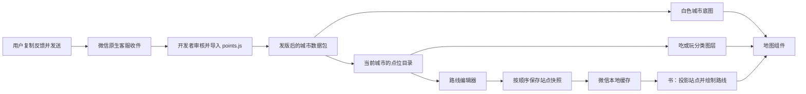

# 茂名吃玩地图 · 微信小程序设计

## 1. 产品范围

首版打开茂名市地图，默认展示「吃」。城市是最小浏览单位，茂南、电白、高州、化州、信宜作为茂名地图内的区域。首页顶部保留城市入口，首版只有茂名可选。以后加入新城市时，同一张地图页面加载对应城市的边界和点位，每座城市有独立的本地路线。

采用原生微信小程序 `WXML + WXSS + JavaScript + Canvas 2D`。白色底图、区划线、点位和路线都在客户端渲染。点位库由开发者维护，随小程序代码包加载，在用户端只读。旅行路线写入微信本地缓存，新增点位的建议由微信原生客服收取。浏览地图和编辑路线无需额外登录、定位权限、地图服务密钥或业务接口。[微信小程序 Canvas 组件](https://developers.weixin.qq.com/miniprogram/dev/component/canvas.html)

## 2. 首页与交互

```text
┌───────────────────────────┐
│ PlayBook 标识              │
│ 茂名 ▾                     │
│                            │
│     信宜市                 │
│           高州市           │
│ 化州市                     │
│          茂南区            │
│             ● 水东鸭粥     │
│                 电白区     │
│ [      点位列表      ]  ◉ │
│ （ [ 吃 ]     玩     书 ） │
└───────────────────────────┘
```

| 入口 | 地图显示 | 点开后的操作 |
| --- | --- | --- |
| 吃 | 当前城市的餐饮点、美食探索区域。黑色圆点配白底黑字标签 | 查看名称、所属城市、详细地址和说明。可添加到正在编辑的路线，或从该点新建路线 |
| 玩 | 当前城市的景点。黑色方形标记配白底黑字标签 | 查看名称、所属城市、详细地址和说明。可添加到正在编辑的路线，或从该点新建路线 |
| 书 | 当前选中路线的编号站点和方向连线 | 点「路线列表」切换、新建、编辑或删除。点地图上的站点可查看对应详情 |

- **版式**：页面使用浅灰背景。顶部左侧显示 PlayBook 标识和名称，右侧留给微信原生胶囊。城市名称放在深色圆角卡片里，下方白色地图占据剩余高度。底部使用带阴影的白色胶囊导航，三个入口均显示图标和文字，当前项用黑底白字，其他项用深色图标和文字。点位列表和新建路线等主要操作使用黑色胶囊按钮。导航留出底部安全区，详情与路线编辑使用底部面板。
- **地图**：白底，浅灰区划线和区县名，路线用黑色虚线及箭头。支持单指拖动、双指缩放、「＋ / －」和「全图」。切换「吃 / 玩」时保持当前地图范围，点路线的「在地图查看」时缩放到该路线。地图下角保留底图来源。
- **用户反馈**使用黑色圆形浮球，球内显示白色对话图标，无障碍名称为「用户反馈」。浮球固定在地图右下角、「吃／玩／书」底栏上方。三个栏目均可点击浮球打开同一个反馈弹窗。地图拖动和缩放时，浮球留在原位。
- **点位**：标签和图标一起可点。密集区域的标签按视口避让，点位列表保留当前类别的全部地点。点列表项时居中并展开详情，便于找到被遮挡的标签。
- **空态**：「书」无保存路线时，地图保留城市轮廓，面板显示「新建路线」。某类无点位时，列表显示「暂无点位」，用户可从地图右下角打开反馈。

## 3. 项目结构与城市数据

```text
playbook/
  app.json
  assets/                     # PlayBook 标识和界面图标
  pages/home/                 # 首页、底栏和面板状态
  components/city-map/        # Canvas 底图、路线、点位与手势
  components/route-editor/    # 选站、排序、保存
  data/
    cities.js                 # 注册已开放地图的城市
    feedback-cities.js        # 全国反馈城市选择目录
    maoming/
      boundaries.js           # 茂名行政边界与区县名称
      points.js               # 开发者维护的「吃 / 玩」点位
  services/
    city-data.js              # 读取城市点位并按 category 筛选
    city-storage.js           # 本地路线读取、校验与保存
tools/
  add-point.js                # 开发者导入反馈，校验后写入城市数据文件
  validate-data.js            # 发包前校验城市包和点位数据
```

`cities.js` 按 `cityId` 注册已开放地图的城市。每个城市包包含 `id`、`provinceName`、`cityName`、`coordSystem`、`bounds`、`boundaries` 和 `points`。茂名使用 `440900`，对应 `provinceName: '广东'` 和 `cityName: '茂名'`。直辖市的两个字段使用同一个去掉末尾「市」的名称，例如北京的 `provinceName` 和 `cityName` 都是 `北京`。`bounds` 从行政边界生成，供首页初始缩放和「全图」使用。新增地图时，在此注册城市数据，首页的地图选择入口自动列出它。

茂名底图可从 DataV 的 `440900_full` 提取区划。打包前简化边界并保留多边形的外环、内环和岛屿，输出小程序可直接 `require()` 的边界数组。底图、点位和路线统一用 `GCJ-02`，坐标顺序为 `[经度, 纬度]`；来自其他坐标系的点位先在数据准备阶段统一转换。边界打包时记录坐标系和来源。[阿里云 DataV.GeoAtlas](https://datav.aliyun.com/portal/school/atlas/area_selector) · [茂名区划数据](https://geo.datav.aliyun.com/areas_v3/bound/440900_full.json)

### 吃和玩共用的点位字段

`points.js` 用同一个数组存放两类点位。两类记录都要求下表的八个字段，字段名、类型和校验规则一致。`category` 是唯一的分类字段。

| 字段 | 用途 |
| --- | --- |
| `id` | 稳定且在城市内唯一，例如 `shuidong-duck`。调整类别时沿用同一个 ID，下架后也不复用其 ID |
| `provinceName` | 去掉末尾「省」的名称，例如 `广东`。直辖市取去掉末尾「市」的名称，例如 `北京` |
| `cityName` | 去掉末尾「市」的名称，例如 `茂名`。直辖市与 `provinceName` 填同一个值 |
| `category` | `eat` 或 `play`，直接决定在哪一个底栏模式显示 |
| `name` | 地图标签及详情标题 |
| `coordinate` | 两个有限数字组成的 GCJ-02 坐标数组，格式 `[lng, lat]` |
| `address` | 详细地址字符串，可从区县写起，填街道、道路、门牌号或景区入口等能帮助找到地点的信息 |
| `description` | 字符串，写地点说明；区域参考点可在这里标明用途 |

点位的省、市名称与城市配置一致。跨城市定位点位时使用 `cityId` 与点位 `id` 的组合，例如 `440900:first-beach`。

`data/maoming/points.js` 示例。水东鸭粥使用水东城区参考点，中国第一滩用近似示例坐标，录入正式数据时可按所选入口复核。首发数据还可加入露天矿生态公园等点位。[水东鸭粥](https://static.nfnews.com/content/202506/30/c11456885.html) · [中国第一滩](https://gdee.gd.gov.cn/attachment/0/550/550199/3014787.pdf) · [露天矿生态公园](https://www.gdfao.gov.cn/zwgk/zdly/mms/content/post_1333163.html)

```js
module.exports = [
  {
    id: 'shuidong-duck',
    provinceName: '广东',
    cityName: '茂名',
    category: 'eat',
    name: '水东鸭粥',
    coordinate: [111.007264, 21.507219],
    address: '电白区水东城区（水东鸭粥探店参考点）',
    description: '水东城区的美食探索区域。可以找一家鸭粥店，搭配鸭肉和鸭杂。'
  },
  {
    id: 'first-beach',
    provinceName: '广东',
    cityName: '茂名',
    category: 'play',
    name: '中国第一滩',
    coordinate: [111.0525, 21.4549],
    address: '电白区南海街道海滨二路中国第一滩景区',
    description: '茂名滨海公园，可安排海边散步。'
  }
]
```

地图、点位列表、详情和路线选点复用同一份数据。切换到「吃」或「玩」时按 `category` 筛选，标记形状也由这个字段选择。两类调用同一个标签组件和详情模板。

```js
const visiblePoints = city.points.filter(point => point.category === activeTab)
const markerShape = { eat: 'circle', play: 'square' }
```

## 4. 用户反馈与开发者录入

首版使用微信小程序原生客服收件。用户在弹窗内复制统一格式的 JSON，再打开客服会话粘贴发送。开发者用微信官方客服工具接收并审核，确认后导入 `points.js` 随新版发布。小程序账号需要具备绑定客服人员的权限，此收件流程无需自建服务端。[微信小程序客服消息](https://developers.weixin.qq.com/miniprogram/dev/framework/open-ability/customer-message/customer-message.html)

### 圆形反馈浮球和统一表单

1. 在画布下方的操作行右侧放置直径 `88rpx` 的 WXML 圆形按钮，与左侧的胶囊按钮并排。缩放控件放在画布上方的工具行。点按浮球打开覆盖地图区域的 WXML 弹窗，弹窗打开期间暂停地图交互。
2. 吃和玩共用同一张表单，必填项为城市、类别、地点名称、详细地址和说明。城市默认选当前地图的城市，点「城市」打开支持搜索的全国城市列表，也可以切换到其他城市。由「吃」或「玩」进入时预选类别，由「书」进入时让用户选择。
3. 点「复制反馈」后校验表单，再用 `wx.setClipboardData` 复制 JSON。复制成功时进入发送提示，显示「已复制，请在客服会话中粘贴并发送」。复制失败时保留表单并提示重试。用户返回修改反馈后，需要重新复制。[微信剪贴板 API](https://developers.weixin.qq.com/miniprogram/dev/api/device/clipboard/wx.setClipboardData.html)
4. 复制成功后显示 `open-type="contact"` 的「打开客服」按钮。用户联网进入微信客服会话，在输入框粘贴并点击发送，开发者在客服工具收到反馈。[微信小程序 button 组件](https://developers.weixin.qq.com/miniprogram/dev/component/button.html)

#### 全国城市选择

`feedback-cities.js` 在开发时根据民政部发布的行政区划名称与代码整理，包含直辖市、地级市等地级行政区和县级市。目录按上文统一去掉名称末尾的「省」或「市」，行政区划代码沿用原值。目录随小程序打包，在本地按名称搜索。表单显示选中的 `cityName`。复制反馈时，从同一条目录记录取出 `cityId` 和 `provinceName`，与 `cityName` 一起写入 JSON。例如从茂名地图进入后改选北京，反馈里的两个名称字段都为 `北京`。[中国·国家地名信息库](https://dmfw.mca.gov.cn/) · [行政区划代码管理办法](https://www.moj.gov.cn/pub/sfbgw/flfggz/flfggzbmgz/202512/t20251204_528920.html)

目录还记录 `mapCityId` 供开发者归档。地级市的 `mapCityId` 为该市自身代码，归入上一级城市地图的县级市则填写上一级代码。下面展示部分目录记录，正式发包使用完整目录。

```js
module.exports = [
  { cityId: '440900', cityName: '茂名', provinceName: '广东', mapCityId: '440900' },
  { cityId: '440981', cityName: '高州', provinceName: '广东', mapCityId: '440900' },
  { cityId: '440100', cityName: '广州', provinceName: '广东', mapCityId: '440100' },
  { cityId: '110000', cityName: '北京', provinceName: '北京', mapCityId: '110000' }
]
```

首页仍从 `cities.js` 读取已开放地图。首版只有茂名地图，其他城市的反馈照常发送给作者。切换反馈城市时保留已填写的文字，并恢复到「复制反馈」状态。作者收到反馈后，按城市、地点名称和详细地址核对坐标。

页面用 `feedbackOpen` 控制弹窗显隐。下面示例展示反馈浮球和客服入口，表单放在弹窗内，`feedbackCopied` 由复制 API 的成功回调设置。

```xml
<!-- 放在 .map-bottom 地图操作行内 -->
<button class="feedback-fab" size="mini" catchtap="openFeedback" aria-label="用户反馈">
  <image class="feedback-icon" src="/assets/icons/chat-dots-light.png" mode="aspectFit" />
</button>

<!-- 放在页面的反馈弹窗内 -->
<button wx:if="{{!feedbackCopied}}" bindtap="copyFeedback">复制反馈</button>
<button wx:if="{{feedbackCopied}}" open-type="contact">
  打开客服
</button>
```

```css
.map-bottom {
  position: relative;
}

.map-bottom .feedback-fab {
  position: absolute;
  right: 0;
  top: 10rpx;
  display: flex;
  align-items: center;
  justify-content: center;
  width: 88rpx;
  min-width: 88rpx;
  max-width: 88rpx;
  height: 88rpx;
  margin: 0;
  padding: 0;
  border-radius: 50%;
  background: #1c1c1e;
  box-shadow: 0 9rpx 20rpx #1c1c1e2e;
}

.feedback-icon { width: 36rpx; height: 36rpx; }

.feedback-fab::after {
  border: 0;
}
```

`openFeedback` 用当前地图城市的 `cityId` 初始化草稿，并显示目录中对应的 `cityName`。用户改选城市时更新草稿里的 `cityId` 和界面上显示的名称。复制时统一查目录生成城市字段和 `coordinate: null`。反馈草稿保存在页面状态。

`copyFeedback` 是首页的事件处理方法。复制失败时，弹窗保留填写内容。

```js
const feedbackCities = require('../../data/feedback-cities.js')

function copyFeedback() {
  const { feedbackDraft } = this.data
  const city = feedbackCities.find(item => item.cityId === feedbackDraft.cityId)
  const { category } = feedbackDraft
  const name = feedbackDraft.name.trim()
  const address = feedbackDraft.address.trim()
  const description = feedbackDraft.description.trim()

  if (!city || !['eat', 'play'].includes(category) || !name || !address || !description) {
    wx.showToast({ title: '请选择城市和类别并填写地点信息', icon: 'none' })
    return
  }

  const feedback = {
    cityId: city.cityId,
    provinceName: city.provinceName,
    cityName: city.cityName,
    category, name, address, description,
    coordinate: null
  }
  wx.setClipboardData({
    data: JSON.stringify(feedback, null, 2),
    success: () => this.setData({ feedbackCopied: true }),
    fail: () => wx.showToast({ title: '复制失败，请重试', icon: 'none' })
  })
}
```

反馈表单显示城市名称和用户填写项，复制时按以下规则生成 JSON。

| 字段 | 来源 |
| --- | --- |
| `cityId` | 小程序从用户选中的目录记录自动带入，例如茂名的 `440900`。导入工具根据该记录的 `mapCityId` 选择地图数据文件 |
| `cityName` | 用户在「城市」选择器里选定的名称，默认使用当前地图城市 |
| `provinceName` | 复制时从所选城市记录自动带入，表单上无需填写 |
| `category`、`name`、`address`、`description` | 用户选择类别并填写地点名称、详细地址和说明 |
| `coordinate` | 复制时固定为 `null`，由开发者按地点名称和详细地址核对后补齐 |
| `id` | 导入脚本为审核通过的新地点生成，首次写入正式 `points.js` 时出现 |

```json
{
  "cityId": "440900",
  "provinceName": "广东",
  "cityName": "茂名",
  "category": "play",
  "name": "茂名露天矿生态公园",
  "coordinate": null,
  "address": "茂南区茂名露天矿生态公园（入口待核对）",
  "description": "建议添加公园入口，方便把它排进周末路线。"
}
```

### 开发者怎样快速录入

#### 1. 在客服端接收 JSON

管理员先在小程序管理后台的「客服」页面绑定接待人员的微信号。开发者使用该微信号扫码登录微信官方客服工具，选择对应的小程序并打开会话。用户粘贴并发送后，开发者收到的消息正文就是上面的 JSON，可整段复制。地图上的点位以开发者审核并发布的数据文件为准。[微信官方客服工具](https://mpkf.weixin.qq.com/)

用手机体验版走一遍「复制反馈 → 打开客服 → 粘贴发送」。在客服工具核对收到的消息里有 `cityId`、`provinceName`、`cityName`、`category`、`name`、`address`、`description` 和固定为 `null` 的 `coordinate`。两类反馈共用同一格式。作者可复制整条消息，补齐坐标后导入。

#### 2. 把已审核反馈添加到 `points.js`

复制消息正文，保存为项目内或开发电脑上的 `feedback.json`。文件只放 JSON 正文。Windows PowerShell 可以在复制后用下方第一行创建文件。打开文件审核地点，按下方步骤核对地图落点，把 `description` 整理成对外展示的说明，然后运行第二行。点位 `id` 由脚本生成。

```powershell
Get-Clipboard -Raw | Set-Content -LiteralPath .\feedback.json -Encoding utf8
node tools/add-point.js --from feedback.json
```

##### 作者如何查找地点坐标

1. 打开高德坐标拾取器，将城市切到反馈里的城市，用「地点名称 + 区县或道路」搜索，例如「茂南区 茂名露天矿生态公园」。同名地点用 `address` 区分，核对后点击正确门店或景区入口。[高德坐标拾取器](https://lbs.amap.com/tools/picker)
2. 点「复制」取得坐标，把 `feedback.json` 里的 `"coordinate": null` 改为两个数字组成的数组，顺序为 `[经度, 纬度]`。高德坐标为 GCJ-02，可与现有底图使用同一套坐标。高德页面提示游客和未认证开发者只显示两位小数，精确定位到门店或入口时，请使用页面提供的登录和认证入口获取完整坐标。[高德坐标系说明](https://lbs.amap.com/faq/advisory/others/39838) · [坐标拾取器精度提示](https://lbs.amap.com/tools/picker)
3. 若搜索结果与地址对不上，先保留这条客服反馈，请用户补充附近地标、详细门牌或入口名。确认落点后再导入。这个查坐标步骤由开发者在浏览器完成，小程序仍从包内 `points.js` 读取正式点位。

下方是茂名首版的导入脚本，可保存为 `tools/add-point.js`。它按反馈的 `cityId` 查目录，核对所选城市名称和所属地图。属于茂名地图的反馈写入 `playbook/data/maoming/points.js`，正式点位里的省、市名称从地图配置读取。作者可以把其他城市的反馈 JSON 保存为待处理文件，等对应地图上线后再录入。脚本还校验类别、必填文字与坐标，并拦截同名且落点很近的重复记录。

```js
const { randomUUID } = require('node:crypto')
const { readFileSync, writeFileSync, renameSync, rmSync } = require('node:fs')
const { resolve } = require('node:path')
const feedbackCities = require('../playbook/data/feedback-cities.js')

function addPoint() {
  const [, , flag, input] = process.argv
  if (flag !== '--from' || !input) {
    throw new Error('用法：node tools/add-point.js --from feedback.json')
  }

  const feedback = JSON.parse(readFileSync(input, 'utf8').replace(/^\uFEFF/, ''))
  const city = { id: '440900', provinceName: '广东', cityName: '茂名' }
  const selectedCity = feedbackCities.find(item => item.cityId === feedback?.cityId)
  if (!selectedCity || feedback.cityName !== selectedCity.cityName ||
      feedback.provinceName !== selectedCity.provinceName) {
    throw new Error('反馈的城市编号、省份名称和城市名称须与目录一致')
  }
  if (selectedCity.mapCityId !== city.id) {
    throw new Error('该城市地图尚未开放，请保留反馈以便后续录入')
  }
  const { category, coordinate } = feedback
  const name = typeof feedback.name === 'string' ? feedback.name.trim() : ''
  const address = typeof feedback.address === 'string' ? feedback.address.trim() : ''
  const description = typeof feedback.description === 'string' ? feedback.description.trim() : ''

  if (!['eat', 'play'].includes(category) || !name || !address || !description) {
    throw new Error('请填写类别、地点名称、详细地址和展示说明')
  }
  if (!Array.isArray(coordinate) || coordinate.length !== 2 || !coordinate.every(Number.isFinite)) {
    throw new Error('请补齐 GCJ-02 坐标，格式为 [经度, 纬度]')
  }
  const [lng, lat] = coordinate
  if (lng < 110.32 || lng > 111.69 || lat < 21.37 || lat > 22.71) {
    throw new Error('坐标超出茂名地图外接范围，请复核')
  }

  const output = resolve(__dirname, '../playbook/data/maoming/points.js')
  const points = require(output)
  const duplicate = points.find(point => {
    const [oldLng, oldLat] = point.coordinate
    return point.name.normalize('NFKC').trim() === name.normalize('NFKC') &&
      Math.hypot(oldLng - lng, oldLat - lat) < 0.001
  })
  if (duplicate) throw new Error(`已有同名邻近点位 ${duplicate.id}，请先核对`)

  const point = {
    id: `p-${randomUUID()}`,
    provinceName: city.provinceName,
    cityName: city.cityName,
    category, name, coordinate, address, description
  }
  const temporary = `${output}.${point.id}.tmp`
  try {
    writeFileSync(temporary, `module.exports = ${JSON.stringify([...points, point], null, 2)}\n`, 'utf8')
    renameSync(temporary, output)
  } finally {
    rmSync(temporary, { force: true })
  }
  console.log(`已添加 ${point.name} ${point.id} 到 ${output}`)
}

try {
  addPoint()
} catch (error) {
  console.error(error.message)
  process.exitCode = 1
}
```

运行成功后打开 `points.js`，确认数组末尾新增一条记录。现有文件会按统一格式序列化，原点位字段值保持原样。遇到无效关键字段或重复点位时，脚本会报错并保留原文件。同名分店或相邻地点由开发者按地址确认，也可以直接按第 3 节的结构手动录入。以后扩展其他城市时，按 `cityId` 从城市注册表读取该市的省、市名称、数据文件路径和坐标范围。

#### 3. 预览并发布新版本

1. 在微信开发者工具中编译现有项目，打开茂名和对应的「吃」或「玩」标签，点进新增地点，检查名称、落点和说明。可再加入一条本地路线验证。
2. 用开发者工具右上角的「上传」，填写新版本号和备注，例如「茂名新增两处景点」。上传后在小程序管理后台的版本管理找到该开发版本。可以先设为体验版，在真机确认。
3. 提交审核，审核通过后发布。用户加载新版本后从新版代码包读取 `points.js`，即可看到标签。多条反馈可以攒到一次发布。常规点位增删改复用同一套页面和地图代码，已有路线继续使用已存站点快照。[微信小程序协同工作和发布](https://developers.weixin.qq.com/miniprogram/dev/framework/quickstart/release.html)

## 5. 旅行路线怎样制作和保存

1. 打开「书」→「新建路线」，输入名称。在当前城市的「吃 / 玩」候选列表勾选地点，按选择顺序加入路线。从点位详情创建路线时，该点自动成为第一站。
2. 用「上移」「下移」调整顺序，点「移除」删站。保存前校验标题及至少两个不同地点，候选列表防止重复选择同一地点。编辑时修改草稿，取消后仍可查看原路线。
3. 保存时以数组顺序记录站点。每站同时保存 `pointId` 和当时的名称、类别、坐标。这样公开点位改名、移位或删除时，已编排路线仍按保存时的站点顺序与位置呈现；用户可在编辑器里主动替换或重新选点。
4. 写入成功后切到「书」，选中此路线并缩放到全部站点。路线列表可以重开、编辑和删除任意已存路线。

### 本地存储约定

每座城市使用一个键，例如 `eat-play-map:city:440900`。一次保存写入该城市的完整状态，避免分别更新路线与当前选择后出现不一致。下面示例对应「水东半日游」。

```json
{
  "schemaVersion": 1,
  "activeRouteId": "route-shuidong-01",
  "routes": [
    {
      "id": "route-shuidong-01",
      "cityId": "440900",
      "name": "水东半日游",
      "stops": [
        {
          "pointId": "shuidong-duck",
          "name": "水东鸭粥",
          "category": "eat",
          "coordinate": [111.007264, 21.507219]
        },
        {
          "pointId": "first-beach",
          "name": "中国第一滩",
          "category": "play",
          "coordinate": [111.0525, 21.4549]
        }
      ]
    }
  ]
}
```

- **写入**：统一通过 `city-storage.js` 调用 `wx.setStorageSync(key, state)`。每次提交先读取最新状态，再按 ID 新增、更新或删除，避免用编辑器打开时的旧副本覆盖另一项修改。同步写入成功后才更新页面状态。写入失败时保留草稿并提供重试。
- **读取**：打开城市时用 `wx.getStorageSync(key)` 读取并校验结构。首次使用返回空路线列表。再次进入「书」时恢复 `activeRouteId`；若它已被删除，选中第一条可用路线，列表为空时展示新建入口。
- **升级和保留**：格式变化时按 `schemaVersion` 迁移。遇到损坏数据或无法识别的新版本时保留原始缓存、提示读取失败，并避免以空数据覆盖。换设备、切换微信账号或清理小程序数据后，原设备上的路线不会自动恢复。[读取本地缓存](https://developers.weixin.qq.com/miniprogram/dev/api/storage/wx.getStorageSync.html) · [写入本地缓存](https://developers.weixin.qq.com/miniprogram/dev/api/storage/wx.setStorageSync.html)

保存路线的核心流程如下。`readCityState` 负责读取和迁移，`validateCityState` 负责校验写入的数据。页面捕获保存异常，成功时使用返回的新状态刷新路线列表和地图。

```js
function saveRoute(cityId, route) {
  const state = readCityState(cityId)
  const index = state.routes.findIndex(item => item.id === route.id)
  const routes = state.routes.slice()
  if (index === -1) {
    routes.push(route)
  } else {
    routes[index] = route
  }

  const next = { ...state, routes, activeRouteId: route.id }
  validateCityState(next, cityId)
  wx.setStorageSync(`eat-play-map:city:${cityId}`, next)
  return next
}
```

## 6. 地图和路线怎样渲染



### 底图和点击

1. 组件内放置 `<canvas type="2d" id="city-map"></canvas>`。布局完成后用 `this.createSelectorQuery().select('#city-map').fields({ node: true, size: true }).exec(...)` 取画布和尺寸。按屏幕像素比设置画布尺寸，并将宽高限制在 Canvas 2D 的范围内。绘制、标签和手势统一使用布局像素。[Canvas 组件](https://developers.weixin.qq.com/miniprogram/dev/component/canvas.html) · [窗口信息](https://developers.weixin.qq.com/miniprogram/dev/api/base/system/wx.getWindowInfo.html)
2. 在城市尺度使用本地等距圆柱近似。令 `lon0`、`lat0` 为城市参考中心，先得到 `u = (lng - lon0) * cos(lat0 * π / 180)`、`v = lat0 - lat`。屏幕坐标为 `x = offsetX + scale * u`、`y = offsetY + scale * v`。全图视角按边界等比适配，拖动修改偏移，缩放修改比例并以手势中心为锚点。城市边界路径、点位和路线共用这个投影。
3. 在白色地图容器中按区划、路线连线、点位图标或编号、文字标签的顺序绘制。标签随画布绘制，点击时使用标签矩形或标记范围定位对应点位。拖动时更新画面，手势结束后重算标签位置并避让。点位列表和路线站点列表保留可直接操作的 WXML 按钮。

页面持有 `cityId`、`activeTab` 和本地城市状态，地图组件持有视口。在一次切栏事件里更新 `activeTab`，将当前分类点位和空路线，或空分类点位和当前路线，传给地图组件。点位更新、路线切换、视口改变后由同一个绘制入口重画。地图回传 `pointtap` 或 `stoptap`，由页面打开对应详情。

### 「书」的路线图层

读取选中路线的 `stops`，按保存顺序映射为屏幕坐标，使用 Canvas `moveTo / lineTo` 连接相邻站点，再画箭头和从 `1` 开始的编号。渲染器从保存的经纬度重新计算画线位置，缩放和重进页面都适用。若两站编号挤在一起，面板可查看完整站序，并点击某站放大定位。

```js
function drawRouteLine(ctx, route, project) {
  const positions = route.stops.map(stop => project(stop.coordinate))

  ctx.save()
  ctx.strokeStyle = '#111111'
  ctx.lineWidth = 3
  ctx.lineJoin = 'round'
  ctx.setLineDash([7, 5])
  ctx.beginPath()
  ctx.moveTo(positions[0].x, positions[0].y)
  for (const point of positions.slice(1)) {
    ctx.lineTo(point.x, point.y)
  }
  ctx.stroke()
  ctx.restore()

  return positions
}
```

上面是通过校验的路线的连线函数。调用后按 `positions` 绘制方向箭头和编号圆点，重合的两站跳过零长度线段的箭头。进入路线时按全部站点计算适配视口，为地图边缘与面板留白，并限制最大缩放。图例标注「按站点连线」，各段代表计划的先后顺序。需要贴近行走轨迹时，可在两个站点之间额外保存一组手工途经坐标，按同一投影绘制。

## 7. 实施顺序与验收

| 顺序 | 实现 | 验收 |
| --- | --- | --- |
| 1 | 建立原生小程序、城市注册表和 Canvas 地图 | 加载茂名，显示白底和区县边界。拖动、缩放、全图可用，地图与底栏在不同屏幕尺寸和安全区下均可操作 |
| 2 | 读点位数据、切分类、开详情 | 「吃」和「玩」切换后只显示对应分类，详情可看到所属城市和详细地址。缩放后标签位置正确。被遮挡的点可从列表找到 |
| 3 | 上线反馈浮球与开发者导入 | 浮球固定在地图右下角，三个栏目均能打开表单。城市默认预选当前地图，可搜索改选。客服收到选中城市的 `cityName`、`cityId`、`provinceName` 和固定为 `null` 的 `coordinate`。作者补齐坐标后，导入工具校验归属并生成正式点位 `id` |
| 4 | 上线路线编辑与存储 | 选两个点，调整顺序后保存。重启后打开「书」，名称、站序、连线与编号恢复。编辑取消、删除和写入失败时按约定处理 |
| 5 | 验证城市隔离与离线体验 | 用开发用城市数据验证不同城市互不串点、串路线。已安装代码包后断网重进，仍可看图、保存和重开路线 |

最小端到端验收可以用「水东鸭粥 → 中国第一滩」完成。先在「吃」打开水东鸭粥并建路线，再在路线编辑里选择中国第一滩。保存后地图出现 `1 → 2`，交换站序后重新保存，编号和方向随之更新。关闭并重新打开小程序，再点「书」，地图恢复同一条路线。
